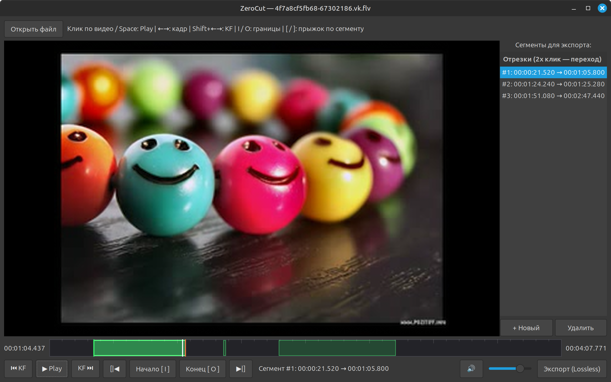

# ZeroCut

Lightweight, fast, portable lossless video & audio cutter and merger written in pure **C** (GTK3 + libmpv + FFmpeg `libavformat`). Designed for **WMV, ASF, WMA, MP4, MKV, AVI** and other formats — zero re-encoding, zero quality loss.



## Features
- **Lossless Cutting & Merging:** Direct stream-copy via custom 64-bit `zerocut-cli` (`libavformat`) with accurate PTS/DTS recalculation.
- **Keyframe Navigation:** Frame-by-frame stepping (`←` / `→`) and exact keyframe jumping (`Shift + ←` / `Shift + →`).
- **Smart Segment Workflow:** Automatically creates and edits segments on the timeline with `I` (In) and `O` (Out), supports multi-segment concatenation, and instant jump to segment boundaries (`[` / `]`).
- **Portable Ready:** Built with `$ORIGIN` RPATH so all `.so` libraries can be bundled inside `lib/` for zero-install portability.

## Build from Source (Ubuntu / Linux Mint / Debian)

```bash
sudo apt install build-essential pkg-config libgtk-3-dev libmpv-dev libavformat-dev libavcodec-dev libavutil-dev
make
./ZeroCut
